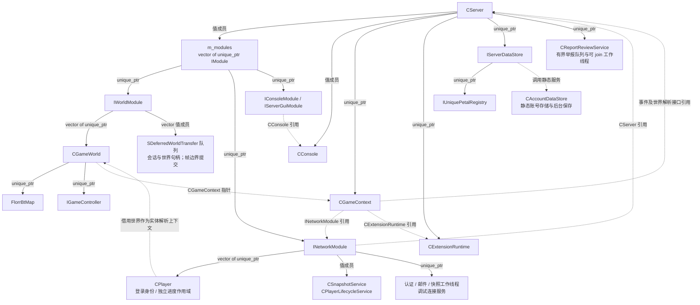
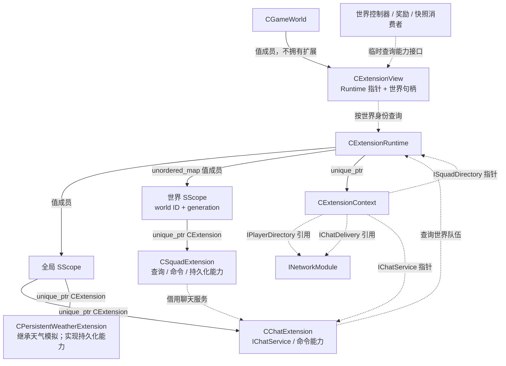
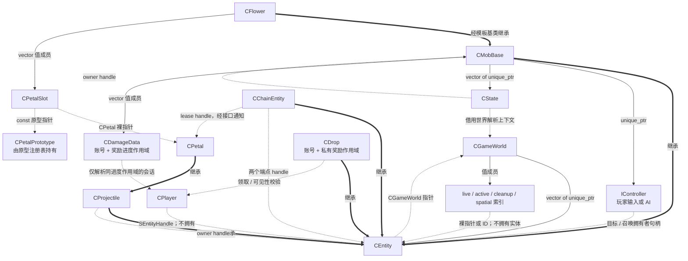
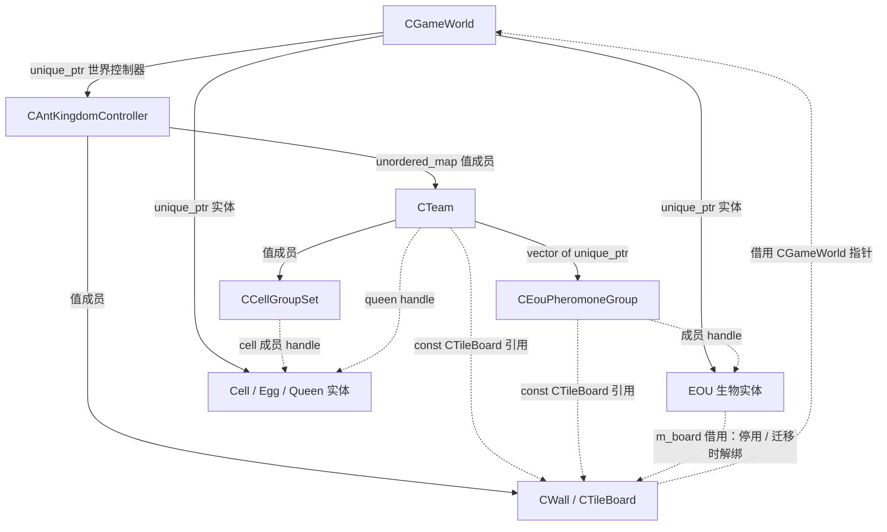
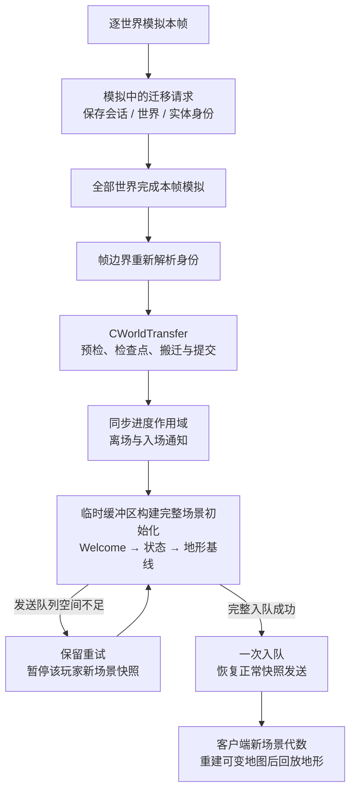

# FlorrBt 当前架构关系图

审查日期：2026-10-24。本文已随边界修复更新，记录运行时主干关系，不是拟议重构方案。
实现与验证状态见 [边界修复记录](boundary-repairs-2026-10-24.md)。

本文包含四张 Mermaid 流程图，可在支持 Mermaid 的 Markdown 预览器中查看，也可直接编辑图的源码。

## 图例与范围

- 实线 `-->`：持有或包含，具体所有权形式见边上的说明。
- 虚线 `-.->`：借用指针、引用、临时查询或句柄关联，不转移所有权。
- 粗线 `==>`：继承，箭头从派生类指向基类。
- 实体句柄包含实体 ID、实体 generation、世界 ID 和世界 instance generation。
- 图中省略具体怪物、花瓣和技能的全部派生类；组合节点表示同类成员的归组，不代表另有一个聚合类。
- EOU 寻路板借用在控制器停用和跨世界迁移时撤销，进入兼容世界后重新绑定。

## 1. 服务器、模块与世界

`CServer` 负责装配。`IWorldModule` 拥有世界，`INetworkModule` 拥有玩家会话；玩家不拥有受控实体。

主要定义：[server.h](../src/Server/server.h)、[world_module.h](../src/Server/Module/world_module.h)、[network_module.h](../src/Server/Module/network_module.h)、[gamecontext.h](../src/Server/Game/gamecontext.h)、[gameworld.h](../src/Server/Game/gameworld.h)。

## 2. 扩展的所有权与访问关系

`CExtensionRuntime` 是扩展的唯一所有者。聊天、天气属于全局作用域，社交队伍属于世界作用域。世界保存非持有的 `CExtensionView`，不使用 `shared_ptr` 共同拥有扩展。

主要定义：[extension.h](../src/Server/Game/extension.h)、[extension_runtime.h](../src/Server/Game/extensions/extension_runtime.h)、[extension_services.h](../src/Server/Game/extensions/extension_services.h)。

## 3. 实体、控制权、花瓣与状态

`CGameWorld` 独占实体。生物拥有其行为控制器和状态；花朵拥有槽位，但槽内花瓣实体仍由世界持有。`IGameController` 是世界玩法控制器，`IController` 是单个生物的行为控制器。

主要定义：[entity.h](../src/Server/Game/entity.h)、[player.h](../src/Server/Game/player.h)、[mob.h](../src/Server/Game/entities/mob.h)、[flower.h](../src/Server/Game/entities/flower.h)、[petal_slot.h](../src/Server/Game/entities/petals/petal_slot.h)、[projectile.h](../src/Server/Game/entities/projectile.h)、[state.h](../src/Server/Game/state.h)、[chain.h](../src/Server/Game/chain.h)。

## 4. EOU 的持有链及借用撤销

EOU 的 `CTeam` 管理玩法蚁群，与扩展中的社交队伍不同。生物由世界持有，寻路板仍属于控制器；控制器停用和实体迁移时撤销借用，目标 EOU 控制器负责重新绑定。

主要定义：[ant_kingdom_controller.h](../src/Server/Game/gamecontrollers/ant_kingdom_controller.h)、[eou_team.h](../src/Server/Game/gamecontrollers/eou_team.h)、[eou_mob.h](../src/Server/Game/entities/eou_mob.h)、[wall_board.h](../src/Server/Game/wall_board.h)。

## 5. 迁移与场景初始化的帧边界

世界模拟以外发起的迁移仍同步执行；模拟内请求先返回 `deferred`，不能当作已经提交。
玩家登录身份不变，沙盒只切换独立的游戏进度作用域。

