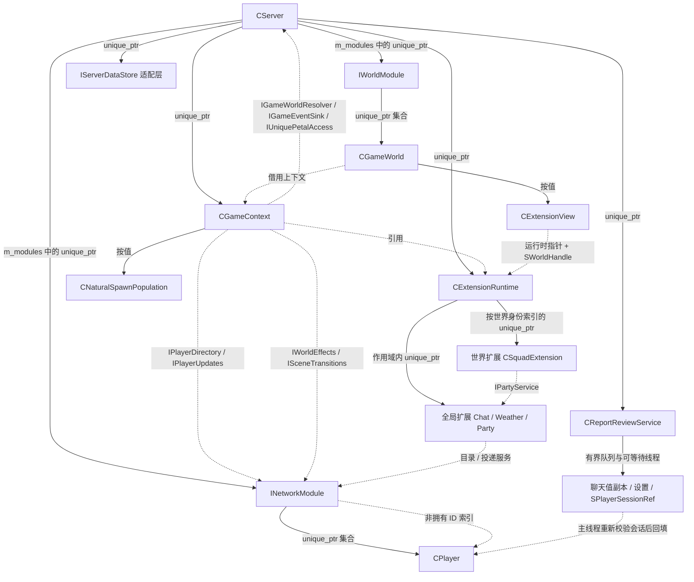
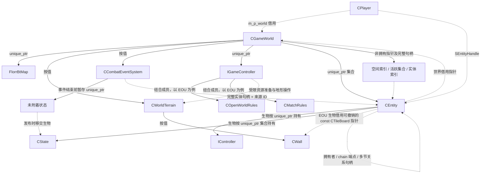
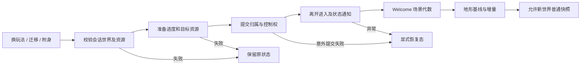

# 当前架构与持有关系（2026-10-31）

这是本轮修改后的实际结构。实线表示拥有，虚线表示借用、句柄解析或服务调用；接口不延长被引用对象的生命周期。

## 装配、服务与扩展

扩展实例由运行时唯一持有，世界保存可失效视图。全局 Party 管跨世界社交关系；世界 Squad 只提供本世界成员视图，比赛阵营由玩法规则负责。它们不是同一个 team 编号。

`IServerDataStore` 适配层仍调用进程级账号存储；上图不能理解为已经支持同进程多个独立账号数据库实例。

## 世界、玩法与实体

地形历史、墙板和几何版本随世界存活；控制器切换不会销毁其内部地形。EOU 停用/迁移仍撤销并重绑借用，不能仅依赖更长生命周期而省略清理。

花朵槽位管理装备、装填及花瓣句柄，花瓣实体的最终所有权仍在世界。附身的控制器租约保留原 AI 与装备；释放时恢复原 AI，无默认 AI 或默认玩家控制器则非击杀移除。NPC 使用独立临时背包，预置装备不流入玩家正式账号。

## 事务、场景与快照

恢复态暂停不完整世界的普通模拟和快照；这不是任意回调异常的强回滚保证。普通快照恢复先保存回滚备份，恢复态直接载入受此限制，见 [剩余架构问题](architecture-fixes-2026-10-31.md#仍需审查的架构取舍)。

有序帧与战斗事件流程单列于 [有序 Tick](ordered-tick-design.md)。快照对象按依赖顺序创建，建立全部身份后再修复引用。网络快照身份与热重载存档版本是两套边界，不能互相替代。
