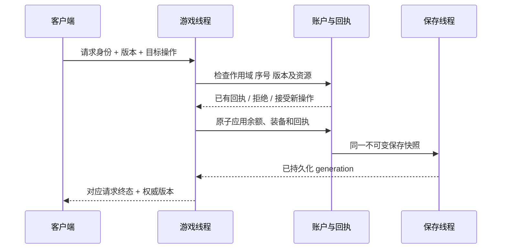

# 经济请求事务的实施契约

状态：A03 的网络、客户端队列、运行时整套换装及保存后的完成通知已接入。账户测试 19/19、基础/协议 94/94、经济运行时 3/3、NPC 背包 3/3 和拒绝路径 1/1 通过，MySQL 原生编译通过。完整运行时曾有一项测试等待干扰，修正后专项通过，完整经过见[实施记录](architecture-remediation-progress-2026-10-25.md)。客户端专项已验证精确 64 位计数器、重发相同字节、重连和背包作用域切换。这不代表全部 15 项架构整改已经完成。

## 请求与结果

每个背包作用域维护独立的单调请求序号和库存版本。请求携带 `request_id + inventory_scope + expected_revision`；响应携带相同请求身份、终态原因和权威版本。原审查用的 `progress_scope` 在 NPC 背包规则确定后进一步细分为物品作用域，避免混淆成长进度与背包。移动输入不进入经济账本。

换装和锻造还携带 `actor_scope`：进程随机身份、世界实例代数、实体代数和 ID。先查询已存在回执，再验证新操作的身体身份；重连可以查询已经完成的原请求，但不能把原请求转用于重生或迁移后的身体。客户端排队时固定身体身份，重试时固定完整字节。

同一账号目前只允许一个在线会话，因此可以使用作用域级连续序号，不必把玩家数字 ID、连接地址或显示名当成事务身份。重连从权威基线取得下一序号；切换沙盒后使用新的进度作用域。旧作用域的请求绝不能对新背包执行。

保存最近一段请求回执，同时保存高水位。序号低于高水位的请求，只能返回已有结果或“结果已超出保留窗口”，不能在回执淘汰后重新执行。相同序号换了配方/目标方案必须拒绝。超过下一连续序号的请求也不执行，防止任意大序号锁死账号。

拒绝、成功及随机合成失败是不同终态；网络等待和持久化等待不是“合成失败”。客户端超时先查询/重试同一请求身份，不生成另一个扣费请求。

## 持久化完成才发布成功

保存线程已经具备失败重试和完整快照合并。新一代快照可以替代旧待写快照，但必须包含其所有已接受交易及回执；因此回执所需 generation 已持久化，才允许发出成功消息。等待期间不能把“入队成功”当成“数据库提交成功”，也不能在返回失败后让旧重试偷偷生效。

不要用同步 `Flush` 阻塞整个游戏线程来等待每次合成。也不要因为某次写盘失败就在内存里回滚、同时让后台继续重试那份已撤销的快照。新操作应有明确的 pending 上限；存储长时间不可用时返回“暂不能接受更多操作”，保留已接受操作的查询能力。

快照回执与高水位必须覆盖 JSON、MySQL、沙盒热重载和账号迁移。业务广播、合成/锻造结果和相关完成反馈也必须走提交结果；不能仅延迟一个返回包，却仍提前广播“已锻造”。

## 整套配装

提交目标主槽和副槽方案，默认整套接受或整套拒绝。单槽操作也可转成同一种目标方案，不再用一串独立卸下/装备包表示一个用户动作。

预检包括：有效身体、模式权限、来源化封槽、花瓣定义/稀有度、槽位边界及总库存守恒。先把原主副槽加入候选资源池，再扣目标方案，允许资源在槽位间交换，避免“背包没有多余副本，所以交换失败”。必须提前验证溢出与缺少资源。

运行时花瓣布局应在预检阶段完成所需分配；提交时清理旧花瓣、交换已准备布局、更新持久化装备。不能用部分成功后逐槽补偿的方式伪装事务；尤其 linker、egg、summon 的清理副作用不能靠把数组值改回去撤销。

客户端可以显示待确认意图，但权威库存和方案不能由动画结束来决定。快速连续操作应排队并使用最新确认版本；发送失败不能推进本地请求序号或丢掉请求身份。

## 需要覆盖的故障测试

- 相同请求重发、重连重发、回执窗口淘汰后的旧序号。
- 同序号不同内容、跨沙盒作用域、过期库存版本。
- 扣费后响应丢失、写盘失败后恢复、合并快照覆盖旧 generation。
- MySQL COMMIT 回复丢失时缓存重建与重试，不再依赖旧差分基线。
- 配装最后一个槽位不合法时，所有槽位、库存和花瓣清理计数均保持不变。
- 双向主副槽交换、Unique 在已装备位置发生转移、热重载后查询回执。
