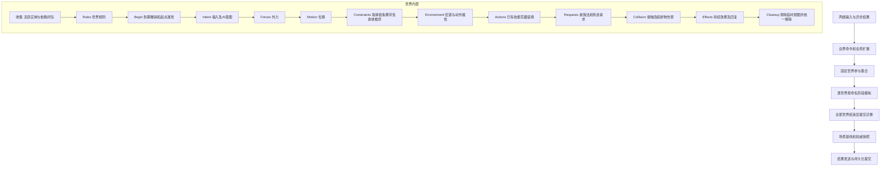
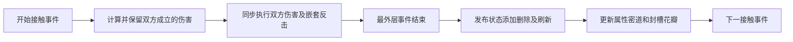

# 有序 Tick 与战斗事件边界

用户已确认：帧起点撤销到期限制，移动后先更新密道，再推进技能和花瓣，同一接触对保留同刻互杀。本文描述 2026-10-31 的实际实现；完整回归结果见 [修复报告](architecture-fixes-2026-10-31.md)。

## 调度和持有边界

[CServer::TickModules](../src/Server/server.cpp) 明确安排网络输入、扩展、世界模拟和网络输出。[IWorldModule::Tick](../src/Server/Module/world_module.cpp) 固定当帧世界集合，在全部世界完成后提交排队迁移。本帧创建的世界下帧参与；跨世界实体不能在目标世界补一次 Tick。

[CEntity::Tick](../src/Server/Game/entity.cpp) 是 final 的单体推进入口，供离线调用使用；正常世界模拟由 [CGameWorld::Tick](../src/Server/Game/gameworld.cpp) 跨实体推进同一阶段。派生类实现命名回调，不再覆盖整体 Tick。世界局部活动标记只用于参与资格和去重，不是跨世界时间。

## 阶段契约

| 阶段 | 已实现行为 |
|---|---|
| 收集 / Rules | 先处理上帧外部移除，固定参与集合和更新权；纳入多节体、携带对象、被抓目标及槽位依赖；控制器准备本帧规则 |
| Begin | 全体生物在产生意图前撤销到期状态；捕获本帧持续效果的值和有效时间，建立起点属性 |
| Intent / Forces / Motion | 玩家和 AI 决策、外力及积分分开；EOU 被玩家控制时不再由实体内路径 AI 覆盖输入 |
| Constraints | 执行结构约束、chain、墙、携带、身体推挤；推挤后只校正嵌墙，不重放整段滑墙 |
| Environment | 根据最终位置发布密道限制与动作属性；stats 和花瓣受限，技能不禁用，states 保持独立生命周期 |
| Actions / Requests | 先推进已有前摇、冷却、装填和花瓣，再执行新施法；新前摇不会立即扣掉整个 dt，结果反馈采用真实执行结果 |
| Collision | 复用动作前缓存的身体接触几何结算伤害，再处理投射物/花瓣；不重复结算身体伤害 |
| Effects | 中毒按本帧有效区间计算，有限状态最后不足 dt 的部分不多算；新状态不补算本帧整段时间 |
| Cleanup | 先清空活跃/碰撞裸指针视图，再统一销毁、解绑及通知，避免临时缓存悬空 |

身体接触缓存只保存每个身体的几何与完整句柄，占用随实体数增长，不保存全部接触对。约束算法保留已有墙、链、携带语义；动作中轨道移动的花瓣另做必要墙约束。

## 命中事件屏障

世界按值拥有 [CCombatEventSystem](../src/Server/Game/systems/combat_events.h)。[CEntity::TakeDamage](../src/Server/Game/entity.cpp) 为 final 入口，包围同步伤害调用；具体实体实现 OnTakeDamage。同一接触对的双向伤害再包一层事件作用域。

- 普通状态添加、删除、刷新以完整实体句柄、来源 ID 和值数据排队，不保留跨事件的状态裸指针。
- Poison、Pincer、Web、Psionic 的构造不修改宿主；合并、替换和附着副作用在发布时发生。丢弃未附着状态不会撤销宿主已有能力。
- 同步伤害仍立即返回，保留反伤、共享生命及灵能分摊的既有判断。这里没有引入通用异步战斗事件总线。
- `DamageProtection` 是显式例外，供第二次机会、绷带续命及复活保护当前伤害；普通命中新无敌只保护后续事件，也不会下帧回补触发它的伤害。
- 装备/玩法派生状态标记为 `rule_managed`。独立 Nullification/Corruption 不会被换装维护删除；快照状态版本 2 保存来源，版本 1 按旧规则迁移。
- 发布失败丢弃尚未发布队列，世界进入恢复态并传播异常；这不等于已经回滚所有先前同步伤害。

## 固定的边界行为

1. 帧起点已到期的无敌/封槽先撤销；帧内耗尽时间的离散限制留到下一起点。持续毒伤只计算剩余有效时间。
2. 帧起点捕获持续效果值。即使中毒在本帧被替换，已经形成的本帧毒伤仍会结算。
3. 密道限制在身体推挤后、动作前发布；离开时按花瓣加载器重新加载，天赋 stats 恢复，states 继续。
4. 同一已成立接触对允许双方互杀。其他新主动动作仍受死亡检查；这不承诺全世界所有同帧命中都作为一个同时批次。
5. 本帧新实体可以进入快照展示，默认下帧才模拟/碰撞；显式即时技能通过自己的同步事件生效。
6. 槽位与世界在帧起点确定推进权，花瓣本帧脱槽后不会再由另一方完整推进一次。
7. 迁移、附身、控制器替换、实体清空及快照捕获不能在模拟/战斗事件内部破坏当前参与集合。
8. 非击杀移除沿用独立移除原因，不产生击杀、掉落、经验和计分。
9. 只有场景基线成功入队后才发送对应普通快照；经济事务仍遵循自己的持久化提交边界。

## 已覆盖的回归及后续边界

运行时回归覆盖：交换插入顺序、到期无敌、短区间毒伤、反复替换中毒、同刻互杀、推挤入密道后动作受限、新生体资格、花瓣脱槽单次推进、玩家/AI 移动后施法、新前摇完整时长、状态构造纯度、独立状态来源、原型状态宿主绑定及事件后封槽清理。

当前能力不等于任意新控制器都会自动遵守所有阶段限制。新增复杂技能仍需选择正确回调，并验证跨实体副作用。世界规则使用专用 Rules 入口，扩展调度保持能力接口；没有开放任意插件按数字优先级插入战斗核心。

恢复态的整服快照载入仍受回滚备份契约限制，跨世界迁移仍有完整检查点成本。这些限制和后续方案在修复报告单列。
